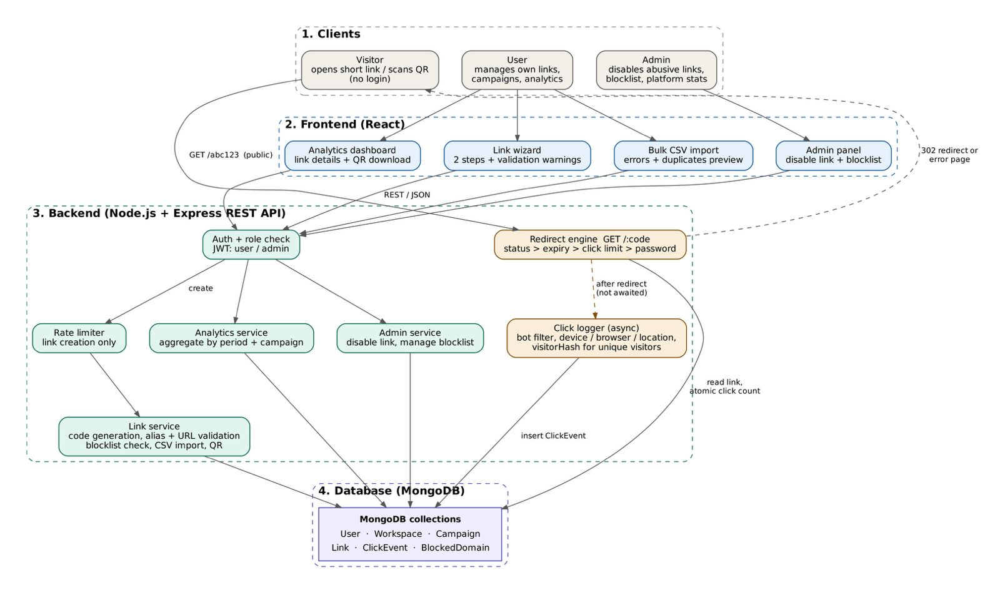
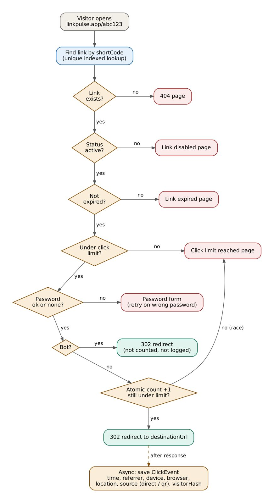
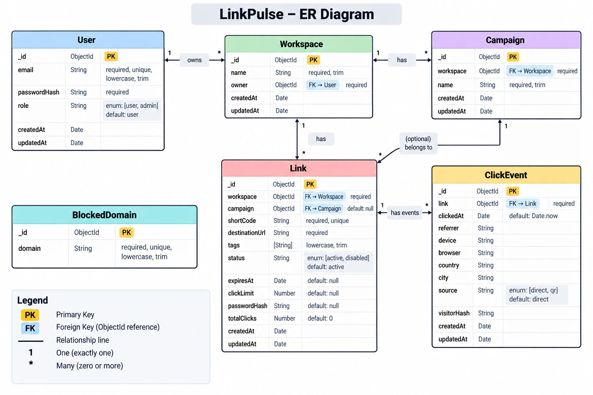

<a id="readme-top"></a>

<div align="center">

# LinkPulse

### An Integrated Link Management, Redirection & Analytics Platform
**Submission for Tech Geeks Hackathon — Round 2: Implementation**

[](https://hertz-club-link-pulse.vercel.app/)
[](https://hertz-club-link-pulse.onrender.com/)

[](https://nodejs.org/)
[](https://expressjs.com/)
[](https://react.dev/)
[](https://vitejs.dev/)
[](https://tailwindcss.com/)
[](https://www.mongodb.com/atlas)
[](#license)


| 🌐 Live Web App | ⚡ Live Backend Service | 🩺 Health Check |
| :---: | :---: | :---: |
| [**hertz-club-link-pulse.vercel.app**](https://hertz-club-link-pulse.vercel.app/) | [**hertz-club-link-pulse.onrender.com**](https://hertz-club-link-pulse.onrender.com/) | [**`/health`**](https://hertz-club-link-pulse.onrender.com/health) |

<br />

[Live Website](https://hertz-club-link-pulse.vercel.app/) · [Live Backend](https://hertz-club-link-pulse.onrender.com/) · [Features](#features) · [Architecture](#architecture) · [Demo Scenarios](#live-demo-walkthroughs) · [API Reference](#api-reference) · [Deployment](#deployment) · [Team](#team)

</div>

---

## Table of Contents

- [About the Project](#about-the-project)
  - [The Problem We Solve](#the-problem-we-solve)
  - [Evaluation Criteria Alignment](#evaluation-criteria-alignment)
- [User Roles & Permissions](#user-roles--permissions)
- [Features & Capabilities](#features--capabilities)
  - [1. Link Creation & Organization](#1-link-creation--organization)
  - [2. Intelligent Redirection Engine](#2-intelligent-redirection-engine)
  - [3. High-Performance Async Click Analytics](#3-high-performance-async-click-analytics)
  - [4. Platform Governance & Safety](#4-platform-governance--safety)
- [How It Works](#how-it-works)
- [System Architecture & Data Model](#system-architecture--data-model)
  - [System Architecture](#system-architecture)
  - [Redirect Engine Flow](#redirect-engine-flow)
  - [Entity-Relationship Diagram](#entity-relationship-diagram)
- [Tech Stack](#tech-stack)
- [Project Structure](#project-structure)
- [Getting Started](#getting-started)
  - [Prerequisites](#prerequisites)
  - [Backend Setup](#1-backend-setup)
  - [Frontend Setup](#2-frontend-setup)
  - [One-Command Development](#3-one-command-development)
  - [Making an Admin Account](#making-an-admin-account)
- [Live Demo Walkthroughs](#live-demo-walkthroughs)
  - [Scenario 1: Link Lifecycle (Creation to Live Analytics)](#scenario-1-link-lifecycle-creation-to-live-analytics)
  - [Scenario 2: Bulk CSV Import & Security Enforcement](#scenario-2-bulk-csv-import--security-enforcement)
- [API Reference](#api-reference)
  - [Public Redirect](#public-redirect-no-login)
  - [Authentication](#authentication)
  - [Workspaces, Campaigns & Links](#workspaces-campaigns--links)
  - [Admin API](#admin-api-role-admin)
  - [Rate Limiting](#rate-limiting)
  - [HTTP Status Codes](#http-status-codes)
- [Deployment](#deployment)
- [Future Roadmap](#future-roadmap)
- [Team](#team)
- [License](#license)

---

## About the Project

Basic URL shorteners only perform a static mapping from a short code to a long destination URL. However, modern marketing, product, and operations teams require links, real-time analytics, and security governance to operate cohesively as a single workflow. 

**LinkPulse** is an integrated link management, routing, and analytics platform where the **Link record is the central operational hub**:
- **Campaigns & Workspaces** provide organizational structure for multi-channel initiatives.
- **Redirect Rules** govern routing dynamically (expiration dates, click caps, password locks, domain blocks).
- **Click Events** capture every visit with privacy-safe visitor fingerprinting and bot filtering.
- **Analytics Dashboard** transforms click streams into actionable conversion insights.
- **Abuse Monitoring & Admin Controls** safeguard the platform from malicious traffic and spam.

### The Problem We Solve

| Pain Point in Traditional Shorteners | How LinkPulse Solves It |
| :--- | :--- |
| **Limited visibility** — Who clicked, when, and from what platform? | Per-link and per-campaign analytics: clicks, unique visitors, devices, browsers, referrers, and direct vs. QR scan attribution. |
| **Lack of post-click control** — Expired or over-allocated links still leak traffic. | Expiry dates, click limits, and bcrypt-hashed password protection enforced on every visit by the redirect engine. |
| **Disorganized campaigns** — Hundreds of links scattered without hierarchy. | Three-tier hierarchy: **Workspace → Campaign → Links**, supported by tags, multi-filter search, and bulk CSV import. |
| **Security & phishing vulnerabilities** — Unsafe links remain live. | Central domain blocklist evaluated at link creation *and* redirection, plus an admin kill-switch to immediately disable suspicious links. |
| **Redirect latency degradation** — Click logging slows down user redirects. | Asynchronous click logging: redirects issue `302 Found` immediately, recording analytics non-blockingly in the background. |

### Evaluation Criteria Alignment

| Evaluation Pillar | Implementation in LinkPulse |
| :--- | :--- |
| **Unified Workflow** | Complete lifecycle integration: Workspace creation → Campaign planning → 2-step Link wizard → QR download → Share → Redirect execution → Async logging → Live analytics. |
| **Robust Business Logic** | Collision-free `nanoid` generation, reserved alias protection, 6-stage redirect rule evaluation, strict click caps, bot exclusion (`isbot`), and client rate limiting. |
| **Production Architecture** | Stateless Express 5 REST API, React 19 SPA, MongoDB Atlas aggregation pipelines, JWT-based RBAC, and salted SHA-256 visitor fingerprinting. |
| **Versatility & Accuracy** | 100% driven by live database queries and real click events — no simulated or hardcoded analytics. |

<p align="right">(<a href="#readme-top">back to top</a>)</p>

---

## User Roles & Permissions

LinkPulse enforces role-based access control (RBAC) across three distinct user roles:

```
┌─────────────────────────┐     ┌─────────────────────────┐     ┌─────────────────────────┐
│   Visitor (Anonymous)   │     │    User (Registered)    │     │      Administrator      │
├─────────────────────────┤     ├─────────────────────────┤     ├─────────────────────────┤
│ • Open short links      │     │ • Manage workspaces     │     │ • Full system overview  │
│ • Enter link passwords  │     │ • Create/edit links     │     │ • Disable abusive links │
│ • View link preview     │     │ • Bulk CSV import       │     │ • Manage domain blocklist│
│ • No management access  │     │ • View own analytics    │     │ • User & link oversight │
└─────────────────────────┘     └─────────────────────────┘     └─────────────────────────┘
```

| Capability | Visitor (Anonymous) | User (Registered) | Admin |
| :--- | :---: | :---: | :---: |
| Access Public Short Links (`/r/:code`) | Yes | Yes | Yes |
| Unlock Password-Protected Links | Yes | Yes | Yes |
| Manage Workspaces & Campaigns | — | Yes (Own) | Yes (All) |
| Create, Edit & Delete Links | — | Yes (Own) | Yes (All) |
| Generate & Download QR Codes | — | Yes | Yes |
| Bulk CSV Link Import | — | Yes | Yes |
| View Link & Campaign Analytics | — | Yes (Own) | Yes (Platform-wide) |
| Disable / Re-enable Any Link | — | — | Yes |
| Manage Blocked Domains Registry | — | — | Yes |
| Platform-wide Analytics Dashboard | — | — | Yes |

<p align="right">(<a href="#readme-top">back to top</a>)</p>

---

## Features & Capabilities

### 1. Link Creation & Organization
- **Smart Code Generator**: Generates clean 7-character short codes using `nanoid` or supports custom aliases (3–30 chars) with reserved keyword blocking (`api`, `login`, `admin`, `health`, etc.).
- **Two-Step Creation Wizard**: Step 1 captures destination URL, alias, campaign, and tags; Step 2 configures routing rules (expiry, click limits, passwords) with live validation warnings.
- **Bulk CSV Import**: Upload hundreds of links via CSV. Built-in parser handles quoted fields, verifies campaign existence, flags duplicate aliases, and generates row-by-row error reports.
- **Dynamic QR Code Generation**: Instant PNG QR code generation with automatic scan tracking tags (`?src=qr`) for physical marketing collateral.
- **Workspaces & Campaigns**: Group links by department, brand, or seasonal marketing campaigns.

### 2. Intelligent Redirection Engine
- **Deterministic 6-Stage Rule Evaluation**:
  1. **Existence Check**: Resolves short code; returns HTTP 404 if missing.
  2. **Status Check**: Verifies link is active; returns HTTP 410 if disabled by owner or admin.
  3. **Expiry Check**: Validates expiration timestamp; returns HTTP 410 if expired.
  4. **Click Limit Check**: Ensures visit count is below threshold; returns HTTP 410 if cap is met.
  5. **Domain Blocklist Check**: Verifies destination against blocked domains list; returns HTTP 403 if blacklisted.
  6. **Password Protection Check**: Validates password session or prompts user via unlock page; returns HTTP 401 if unauthorized.
- **Dual Output Support**: Returns HTTP `302 Found` redirects for standard browsers, or JSON metadata when queried with `?format=json`.

### 3. High-Performance Async Click Analytics
- **Zero-Latency Redirects**: Redirects are dispatched to the visitor immediately; click events are processed asynchronously in the background.
- **Bot & Crawler Filtering**: Automatic filtering of web crawlers, search engine previewers, and scrapers using `isbot` to ensure clean, accurate data.
- **Privacy-Preserving Unique Visitors**: Unique visitors are counted via salted SHA-256 hashes (`visitorHash = SHA-256(clientIp + userAgent + salt)`). No raw IP addresses are permanently stored.
- **Multi-Dimensional Metrics**:
  - Total clicks vs. unique visitors
  - Device breakdown (Desktop, Mobile, Tablet)
  - Browser breakdown (Chrome, Safari, Firefox, Edge, Opera, Other)
  - Traffic source breakdown (Direct visits vs. QR code scans)
  - Top referrers analysis
  - Granular time-series charts over `24h`, `7d`, `30d`, or `all`
- **Persistent Analytics**: Historical analytics remain accessible even after a link has expired, reached its limit, or been disabled.

### 4. Platform Governance & Safety
- **Domain Blocklist Registry**: Prevents malicious domains, malware, or phishing destinations from being shortened or redirected. Enforced at link creation *and* at redirect time.
- **Administrative Kill-Switch**: Admins can immediately disable suspicious or abused short links from the admin dashboard without deleting data.
- **Brute-Force & Abuse Rate Limiting**: Built-in rate limiters using `express-rate-limit` protecting auth endpoints, link creation, CSV batch imports, and password unlock gates.
- **Enterprise Security**: Passwords hashed using `bcrypt` (cost factor 12), request validation via `zod`, and secure tokenized authentication using JWT.

<p align="right">(<a href="#readme-top">back to top</a>)</p>

---

## How It Works

```
┌─────────────┐     ┌─────────────┐     ┌─────────────┐     ┌─────────────┐     ┌─────────────┐
│ 1. CREATE   │ ──► │  2. SHARE   │ ──► │ 3. REDIRECT │ ──► │ 4. ANALYZE  │ ──► │  5. MANAGE  │
└─────────────┘     └─────────────┘     └─────────────┘     └─────────────┘     └─────────────┘
  Build link via      Distribute          6-stage rule        Non-blocking        Audit rules,
  2-step wizard or    short URL or        evaluation;         async click         disable links,
  bulk CSV import     dynamic QR          immediate 302       logging & charts    or block domains
```

1. **Create**: User supplies destination URL, chooses an alias, groups into a workspace/campaign, and configures rules.
2. **Share**: Short link (`/r/:shortCode`) or QR code is published on social media, email newsletters, or print ads.
3. **Redirect**: When clicked, the engine validates the link status, expiry, limits, blocklist, and password, redirecting valid visitors within milliseconds.
4. **Analyze**: The click event is logged asynchronously, cataloging visitor device, browser, referrer, and source into real-time aggregations.
5. **Manage**: Owners review link performance, edit expiry or click limits, and admins oversee platform safety.

<p align="right">(<a href="#readme-top">back to top</a>)</p>

---

## System Architecture & Data Model

### System Architecture

LinkPulse adopts a three-tier decoupled architecture:

<p align="center">
  
</p>

### Redirect Engine Flow

Every incoming redirect request is evaluated against a strict sequence of conditions before issuing a 302 redirect:

<p align="center">
  
</p>

### Entity-Relationship Diagram

Six primary MongoDB collections maintain relational integrity and data isolation:

<p align="center">
  
</p>

| Collection | Role | Key Fields |
| :--- | :--- | :--- |
| **User** | Platform accounts with role-based access | `name`, `email`, `passwordHash`, `role` (`user` / `admin`) |
| **Workspace** | High-level organizational boundary | `name`, `owner` (ref: User) |
| **Campaign** | Grouping of related promotional links | `name`, `description`, `workspace` (ref: Workspace) |
| **Link** | Central link record with routing rules | `shortCode`, `destinationUrl`, `workspace`, `campaign`, `tags`, `status`, `expiresAt`, `clickLimit`, `passwordHash`, `totalClicks` |
| **ClickEvent** | Granular visit logs for analytics | `link`, `clickedAt`, `referrer`, `device`, `browser`, `source`, `visitorHash` |
| **BlockedDomain**| Platform safety blacklist | `domain`, `reason`, `createdBy` |

<p align="right">(<a href="#readme-top">back to top</a>)</p>

---

## Tech Stack

| Layer | Technologies | Justification & Purpose |
| :--- | :--- | :--- |
| **Frontend Framework** | **React 19** + **Vite 6** | Modern component architecture, ultra-fast HMR, and smooth client-side routing with React Router 7. |
| **Styling** | **Tailwind CSS 4** | Clean, responsive design system with custom brand color palettes and micro-animations. |
| **Backend Runtime** | **Node.js (≥ 20)** + **Express 5** | Non-blocking asynchronous event loop with native modern JavaScript support. |
| **Database & ODM** | **MongoDB Atlas** + **Mongoose 8** | Flexible document modeling with complex aggregation pipelines for real-time analytics. |
| **Security & Auth** | **JWT** + **bcrypt** + **Zod** | Stateless JWT authentication, role guards, bcrypt password hashing, and runtime schema validation. |
| **Rate Limiting** | **express-rate-limit** | Protection against brute-force attacks and resource exhaustion on auth and link creation endpoints. |
| **Utilities** | **nanoid**, **isbot**, **qrcode** | Collision-resistant short code generation, web crawler filtering, and on-demand QR code rendering. |
| **Hosting** | **Vercel** (Frontend) + **Render** (Backend) | Globally distributed frontend CDN with auto-deploying backend web services. |

<p align="right">(<a href="#readme-top">back to top</a>)</p>

---

## Project Structure

```
LinkPulse/
├── backend/
│   ├── src/
│   │   ├── config/              # MongoDB connection & environment configuration
│   │   ├── controllers/         # Business logic (auth, workspace, campaign, link, redirect, admin)
│   │   ├── middleware/          # JWT auth, role guard, rate limiting, and Zod validator
│   │   ├── models/              # Mongoose schemas (User, Workspace, Campaign, Link, ClickEvent, BlockedDomain)
│   │   ├── routes/              # Express REST route definitions
│   │   ├── utils/               # Short code generator, async click logger, analytics aggregations, ApiError
│   │   ├── zod-schema/          # Request validation schemas
│   │   ├── app.js               # Express application initialization & middleware stack
│   │   └── server.js            # Server bootstrap & database listener
│   ├── jsconfig.json            # Module resolution configuration
│   └── package.json
├── frontend/
│   ├── src/
│   │   ├── features/
│   │   │   ├── auth/            # Landing page, Login, Register, AuthContext, Auth Guards
│   │   │   └── link-pulse/      # Dashboard, Links panel, Campaigns panel, Analytics, Admin console, Modals
│   │   ├── App.jsx              # Application router & layout structure
│   │   ├── main.jsx             # React entry point
│   │   └── styles.css           # Global Tailwind design tokens
│   ├── vercel.json              # SPA routing rewrites for Vercel
│   └── package.json
└── docs/
    └── images/                  # System diagrams (Architecture, Redirect Flow, ERD)
```

<p align="right">(<a href="#readme-top">back to top</a>)</p>

---

## Getting Started

### Prerequisites

- **Node.js ≥ 20.0.0** and **npm**
- A **MongoDB Atlas** connection string (or a local MongoDB instance: `mongodb://localhost:27017/linkpulse`)

---

### 1. Backend Setup

```bash
cd backend
npm install
cp .env.example .env
```

Configure your **`backend/.env`**:

```env
PORT=3000
NODE_ENV=development
MONGODB_URI=mongodb+srv://<username>:<password>@cluster0.xxx.mongodb.net/Link-pulse?retryWrites=true&w=majority
JWT_SECRET=your_super_secret_jwt_key_here
JWT_EXPIRES_IN=1d
BASE_URL=http://localhost:3000
FRONTEND_URL=http://localhost:5173
```

Start the backend development server:

```bash
npm run dev
# Server running on http://localhost:3000
```

---

### 2. Frontend Setup

In a new terminal window:

```bash
cd frontend
npm install
cp .env.example .env
```

Configure your **`frontend/.env`**:

```env
VITE_API_BASE_URL=http://localhost:3000/api/v1
```

Start the frontend development server:

```bash
npm run dev
# Frontend running on http://localhost:5173
```

---

### 3. One-Command Development

From the root directory, you can also start both servers concurrently:

```bash
npx concurrently -n "backend,frontend" -c "blue,green" "npm run dev --prefix backend" "npm run dev --prefix frontend"
```

Open **http://localhost:5173** in your browser.

---

### Making an Admin Account

By default, newly registered users have the `user` role. To elevate an account to `admin`:

1. Register an account through the UI at `http://localhost:5173/register`.
2. Connect to your MongoDB database using `mongosh` or MongoDB Compass and run:

```javascript
use Link-pulse;
db.users.updateOne(
  { email: "your-email@example.com" },
  { $set: { role: "admin" } }
);
```

3. Sign out and log back in. The **Admin Console** tab will now appear in your navigation bar.

<p align="right">(<a href="#readme-top">back to top</a>)</p>

---

## Live Demo Walkthroughs

The following two 5-minute walkthrough scenarios can be used to evaluate LinkPulse during hackathon demonstrations:

### Scenario 1: Link Lifecycle (Creation to Live Analytics)

1. **Sign Up & Workspace Creation**:
   - Register a new account (`alice@example.com`). Notice a default workspace is automatically provisioned.
2. **Create a Campaign**:
   - Navigate to the **Campaigns** tab and click **New Campaign** (e.g., `"Spring Product Launch"`).
3. **Build a Link with Custom Rules (2-Step Wizard)**:
   - Click **Create Link**.
   - **Step 1**: Enter Destination URL (`https://github.com`), set Custom Alias (`spring-launch`), assign to `"Spring Product Launch"`, and add tags `launch, promo`.
   - **Step 2**: Enable a Click Limit (e.g., `5` clicks) and an Expiration Date. Click **Create Link**.
4. **Distribute & Test Redirection**:
   - Copy the short URL (`http://localhost:3000/r/spring-launch`) or download its QR code.
   - Open a private browser window and visit the short URL. Verify that it instantly issues a 302 redirect to GitHub.
5. **Inspect Live Analytics**:
   - Return to the LinkPulse dashboard and select the link.
   - Observe live real-time metrics: click count, unique visitor attribution, device category (desktop/mobile), browser, and timeline graph.

---

### Scenario 2: Bulk CSV Import & Security Enforcement

1. **Bulk CSV Import with Error Reporting**:
   - Navigate to **Links** and click **Import CSV**.
   - Upload a CSV containing valid and invalid entries.
   - Click **Upload & Import**. Notice the granular report showing that `react-docs` succeeded, while `broken-link` was rejected for an invalid URL and `spring-launch` was flagged as a duplicate alias.
2. **Password Protection & Unlock Flow**:
   - Edit a link or create a new one with a Password lock (e.g., `secret123`).
   - Visit the short URL. The system serves an intuitive password challenge page.
   - Entering an invalid password displays a friendly retry alert; entering `secret123` redirects to destination.
3. **Admin Domain Blocklist & Kill Switch**:
   - Log in as an **Admin** user and open the **Admin Console**.
   - Add a malicious domain to the Blocklist (e.g., `phishing-test.com`).
   - Attempt to create a link pointing to `https://phishing-test.com` — creation is immediately rejected with HTTP 400.
   - Locate any existing link in the Admin table and toggle its status to **Disabled**. Visiting that link immediately serves a clean 410 "Link Disabled" page.

<p align="right">(<a href="#readme-top">back to top</a>)</p>

---

## API Reference

Base API Path: `/api/v1`  
Production Base URL: [`https://hertz-club-link-pulse.onrender.com/api/v1`](https://hertz-club-link-pulse.onrender.com/api/v1)  
Authentication: `Authorization: Bearer <JWT_TOKEN>`  
Health Check: [`GET https://hertz-club-link-pulse.onrender.com/health`](https://hertz-club-link-pulse.onrender.com/health)

### Public Redirect (No Login)

| Method | Endpoint | Description |
| :--- | :--- | :--- |
| `GET` | `/r/:shortCode` | Evaluates routing rules and returns HTTP `302 Found` (or JSON if `?format=json`). |
| `GET` | `/r/:shortCode/preview` | Returns link metadata (destination is redacted if password protected). |
| `POST` | `/r/:shortCode/verify-password` | Validates link password and returns the unlocked destination URL. |

### Authentication

| Method | Endpoint | Description |
| :--- | :--- | :--- |
| `POST` | `/api/v1/auth/register` | Creates a new user account and provisions a default workspace. |
| `POST` | `/api/v1/auth/login` | Authenticates credentials and returns a JWT access token. |
| `GET` | `/api/v1/auth/me` | Returns current authenticated user profile and role. |

### Workspaces, Campaigns & Links

| Method | Endpoint | Description |
| :--- | :--- | :--- |
| `GET` `POST` | `/api/v1/workspaces` | List all user workspaces / create a new workspace. |
| `GET` `PATCH` `DELETE` | `/api/v1/workspaces/:id` | Retrieve, update name, or delete a workspace. |
| `GET` `POST` | `/api/v1/campaigns` | List workspace campaigns / create a campaign. |
| `GET` `PATCH` `DELETE` | `/api/v1/campaigns/:id` | Retrieve, update, or delete a campaign. |
| `GET` | `/api/v1/campaigns/:id/analytics` | Retrieve aggregated campaign-level click analytics. |
| `GET` `POST` | `/api/v1/links` | List links (with search, campaign, tag filters) / create a link. |
| `POST` | `/api/v1/links/import` | Bulk import links via CSV (`Content-Type: text/csv`). |
| `GET` `PATCH` `DELETE` | `/api/v1/links/:id` | Retrieve link details, update link rules, or delete a link. |
| `GET` | `/api/v1/links/:id/qr` | Generate downloadable PNG QR code for the link. |
| `GET` | `/api/v1/links/:id/analytics` | Query link analytics over timeframes (`24h`, `7d`, `30d`, `all`). |

### Admin API (Role: `admin`)

| Method | Endpoint | Description |
| :--- | :--- | :--- |
| `GET` | `/api/v1/admin/analytics` | Query platform-wide aggregate counts and metrics. |
| `GET` | `/api/v1/admin/users` | List all registered users across the platform. |
| `GET` | `/api/v1/admin/links` | Inspect all links created across all workspaces. |
| `PATCH` | `/api/v1/admin/links/:id/status` | Force disable or re-enable any link on the platform. |
| `GET` `POST` | `/api/v1/admin/blocked-domains` | List all blocked domains / add a new blocked domain. |
| `DELETE` | `/api/v1/admin/blocked-domains/:id` | Remove a domain from the blocked domain registry. |

### Rate Limiting

Endpoints are safeguarded against brute-force attacks and volumetric spam using `express-rate-limit`:

| Scope | Protected Endpoints | Hardcoded Limit | Keyed By |
| :--- | :--- | :--- | :--- |
| **Login** | `POST /api/v1/auth/login` | 10 requests / 15 minutes | Client IP |
| **Registration** | `POST /api/v1/auth/register` | 10 accounts / 1 hour | Client IP |
| **Auth General** | `/api/v1/auth/*` | 30 requests / 15 minutes | Client IP |
| **Link Creation** | `POST /api/v1/links` | 60 links / 15 minutes | User ID (or IP) |
| **CSV Import** | `POST /api/v1/links/import` | 10 imports / 15 minutes | User ID (or IP) |
| **Password Unlock** | `POST /r/:shortCode/verify-password` | 15 attempts / 15 minutes | Client IP |

*All limit violations return HTTP `429 Too Many Requests` with standard IETF Draft-8 (`RateLimit`, `RateLimit-Policy`) and legacy (`X-RateLimit-*`) headers.*

### HTTP Status Codes

| Status Code | Meaning in LinkPulse |
| :---: | :--- |
| `200` | Successful request / data retrieved. |
| `201` | Resource created successfully (user, workspace, campaign, link). |
| `302` | Temporary redirect to target destination URL. |
| `400` | Bad Request — invalid parameters, schema validation failed, or blocked domain. |
| `401` | Unauthorized — missing/invalid JWT or link password required. |
| `403` | Forbidden — insufficient permissions or destination domain is blocked. |
| `404` | Not Found — route, short code, or resource does not exist. |
| `409` | Conflict — custom alias or email address already in use. |
| `410` | Gone — link has expired, reached its click limit, or been disabled. |
| `429` | Too Many Requests — rate limit threshold reached. |
| `500` | Internal Server Error. |

<p align="right">(<a href="#readme-top">back to top</a>)</p>

---

## Deployment

LinkPulse is live and deployed for production:

| Layer | Platform | Live URL / Endpoint | Configuration & Notes |
| :--- | :--- | :--- | :--- |
| **Frontend** | **Vercel** | [**hertz-club-link-pulse.vercel.app**](https://hertz-club-link-pulse.vercel.app/) | Root directory: `frontend`, build command: `npm run build`, output: `dist`. Uses `vercel.json` rewrite rules to route all paths to `index.html`. Configured with `VITE_API_BASE_URL`. |
| **Backend** | **Render** | [**hertz-club-link-pulse.onrender.com**](https://hertz-club-link-pulse.onrender.com/) ([Health Status](https://hertz-club-link-pulse.onrender.com/health)) | Root directory: `backend`, build command: `npm install`, start: `npm start`. API Base: `/api/v1`. Environment variables: `MONGODB_URI`, `JWT_SECRET`, `FRONTEND_URL`, `BASE_URL`. |
| **Database** | **MongoDB Atlas** | Cloud Replica Set | Dedicated MongoDB Atlas cluster with network access allowed for Render backend web service. |


<p align="right">(<a href="#readme-top">back to top</a>)</p>

---

## Wht's done

- [x] Link creation with nanoid short codes and custom aliases
- [x] 6-stage 302 redirect engine with expiry, click caps, and password locks
- [x] High-performance async click logging with bot filtering (`isbot`)
- [x] Privacy-preserving unique visitor tracking via salted SHA-256 hashes
- [x] Workspaces, campaigns, and bulk CSV import with error reporting
- [x] Multi-device, browser, referrer, and source analytics dashboards
- [x] Admin console with platform oversight, link disable toggle, and domain blocklist
- [x] Production rate limiting on auth, link creation, and password verify endpoints

<p align="right">(<a href="#readme-top">back to top</a>)</p>

---

## Team

**Hertz Club** — Tech Geeks  
*Graphic Era Hill University, Haldwani Campus*

| Name 
| :--- |
| **Harshvardhan**
| **Rahul Raj Singh** 
| **Abhay Singh** 
| **Lakshya Agarwal**

